# Regex IR

Regex IR is an experimental, composable C++20 regex compiler and CUDA code
generator. It turns a pattern and an operation into a device function that an
application can call from its own CUDA kernels. The application supplies input
storage, output allocation, kernel scheduling, and compilation of the generated
source.

# How Regex IR Works

Regex IR parses the pattern into an abstract syntax tree and builds an ordered
Thompson nondeterministic finite automaton (NFA). Lowering converts the automaton
into an instruction IR, and optimization simplifies the instructions. The code
generator selects an executor for the pattern and requested operation, then emits
CUDA C++ source. Specialized literal and automaton executors handle suitable
patterns; an iterative Thompson executor handles the general case.

```mermaid
flowchart LR
    Pattern[Pattern and options] --> Parser[Parser and Thompson builder]
    Parser --> NFA[Automata IR]
    NFA --> Lowering[Lowering]
    Lowering --> Optimizer[Instruction IR optimization]
    Optimizer --> Codegen[Executor selection and CUDA code generation]
    Codegen --> Source[Device function source and metadata]
    Source --> Adapter[Application kernel and storage adapter]
    Adapter --> Compiler[CUDA compilation and linking]
    Compiler --> Kernel[Reusable GPU kernel]
```



The host compiler interface is [regex_ir.hpp](regex_ir.hpp). Generated source
uses the shared device runtime in [executor.cuh](executor.cuh). Compiler passes,
tables, and integration helpers live in [detail/](detail/).

# Usage

## Compile a pattern

```cpp
#include <libregex_ir/regex_ir.hpp>

regex_ir::compile_result compile_words()
{
  regex_ir::compile_options options;
  options.case_insensitive = true;
  return regex_ir::compile(R"(\bcat\b)", regex_ir::operation_kind::CONTAINS,
                           std::nullopt, options);
}
```

Select the operation at compilation: contains, match-at-start, count, find,
extraction, find-all, replacement, or split. `compile_options` controls character
decoding, matching flags, observable capture groups, and resource limits.
`REPLACE` requires a replacement argument; other operations reject it.
Compilation errors are reported as `std::invalid_argument`, with a pattern byte
offset for parser and compiler diagnostics.

The returned `compile_result` contains the generated `cuda_source`, capture count,
selected executor, and workspace requirements. It also identifies exact literals
and adapted repeated predicates when recognized, allowing an embedding application
to select additional fast paths.

## Compose a CUDA kernel

Include `libregex_ir/executor.cuh`, append `cuda_source`, and append your kernel.
The default generated entry point is named `regex_ir_execute`. For the
zero-workspace `CONTAINS` example above, a wrapper for a single input is:

```cuda
extern "C" __global__ void contains_word(char const* data,
                                       regex_ir::device::i64 size,
                                       bool* result)
{
  if (blockIdx.x == 0 && threadIdx.x == 0) {
    *result = regex_ir_execute(data, size);
  }
}
```

`data` points to device memory and `size` is its byte length; input need not be
null-terminated. A batch wrapper can assign inputs to threads using its own
offset array, pointer/length pairs, or another layout. The matcher operates on
individual inputs and does not require a column representation.

The device signature depends on the operation and metadata. For example, find
and extraction write spans, replacement accepts an output buffer, and a nonzero
`workspace_bytes` adds a leading `char* workspace` argument. Supply that many
bytes of eight-byte-aligned device storage per concurrent worker. Sequential
calls can reuse the same workspace without initialization. The generated
signature is authoritative; [cuda_abi.hpp](detail/cuda_abi.hpp) centralizes its
internal descriptions.

Default compilations reuse the same entry-point and internal namespace names.
Keep different patterns in separate modules unless you customize their names
through the internal code-generation facilities.

## Compile and reuse

Compile the assembled source with a CUDA compiler, making the parent of
`libregex_ir` available as an include directory. NVRTC can compile it at runtime;
applications may also compile generated source ahead of execution. The matcher
and wrapper can share a translation unit or be compiled separately and linked
with device LTO, using matching device declarations.

Load the kernel, allocate application-owned inputs and outputs, launch it, and
reuse the compiled kernel for subsequent inputs. Keep compilation and module
caching in the embedding application; `regex_ir::compile` itself returns source
and metadata.

# Adapting Regex IR

An adapter translates its storage layout into matcher inputs, allocates output
and workspace buffers, and chooses how workers process inputs. It can compose
matching with other device work in the same kernel. Variable-size outputs may
need a sizing pass followed by allocation and an emission pass.

When `compile_result::repeated_builtin` is set, the selected count fast path
accepts an additional `char const* flags` argument and calls the device hook
`regex_ir_repeated_builtin(code_point, flags)`. The adapter supplies this hook
for the reported `builtin_character_class`, using its own predicate tables or
implementation. See the declaration in [executor.cuh](executor.cuh) and the
example implementation emitted by `make_fixed_kernel` below.

The cuDF integration is one example of these responsibilities:

- [kernel_ir.hpp](../../src/strings/experimental/regex_jit/kernel_ir.hpp) and
  [kernel_ir.cpp](../../src/strings/experimental/regex_jit/kernel_ir.cpp) generate
  kernel wrappers, matching ABI declarations, and the repeated-predicate hook.
- [kernels.cuh](detail/kernels.cuh) adapts offset arrays and validity masks,
  assigns work, and materializes outputs, including sizing and emission passes.
- [pair.cuh](detail/pair.cuh) defines its intermediate pointer/length output layout.
- [regex.cu](../../src/strings/experimental/regex_jit/regex.cu) manages NVRTC
  compilation, device LTO linking, retained kernels, workspace, and launch policy.

These helpers illustrate a column-oriented adapter. Other applications can
provide their own wrappers and policies while using the same compiler and device
runtime.

# Supported Features

- UTF-8 code-point matching or byte matching.
- Literals, dot, character classes, negated classes, ranges, and POSIX classes.
- Shorthand classes `\d`, `\w`, `\s` and their negations, with ASCII or Unicode
  semantics; Unicode math-symbol properties `\p{Sm}` and `\P{Sm}`.
- Alternation, capturing groups, and noncapturing groups `(?:...)`.
- Greedy and lazy repetition: `*`, `+`, `?`, and bounded repetitions.
- Line anchors `^` and `$`, input anchors `\A`, `\Z`, `\z`, and word-boundary
  assertions `\b` and `\B`. Both `\Z` and `\z` mean strict end of input.
- Positive and negative lookahead (`(?=...)`, `(?!...)`) and lookbehind
  (`(?<=...)`, `(?<!...)`), including variable-length lookbehind.
- Case-insensitive matching, multiline anchors, dot-all matching, and extended
  newline handling through compilation options.
- Prefix flags such as `(?im)` and scoped flags such as `(?i:...)`, including
  `i` (ignore case), `m` (multiline), `s` (dot-all), `a` (ASCII), `u` (Unicode),
  and `x` (ignore unescaped whitespace and line comments outside character classes).
  Scoped groups can disable `i/m/s/x`, as in `(?im-sx:...)`; settings are restored
  on leaving the group. `a` and `u` are mutually exclusive overrides and cannot be
  disabled. Bare directives apply from their position to the end of the enclosing
  group, including subsequent alternatives. `u` requires UTF-8 mode.
- Contains, match-at-start, count, find, capture extraction, find-all, replacement,
  and split operations. Match-at-start does not require consuming the whole input.

Named groups, pattern backreferences, atomic groups, and possessive quantifiers
are unsupported.
