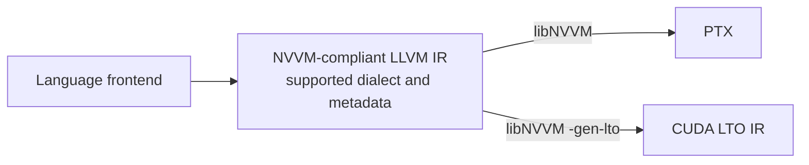
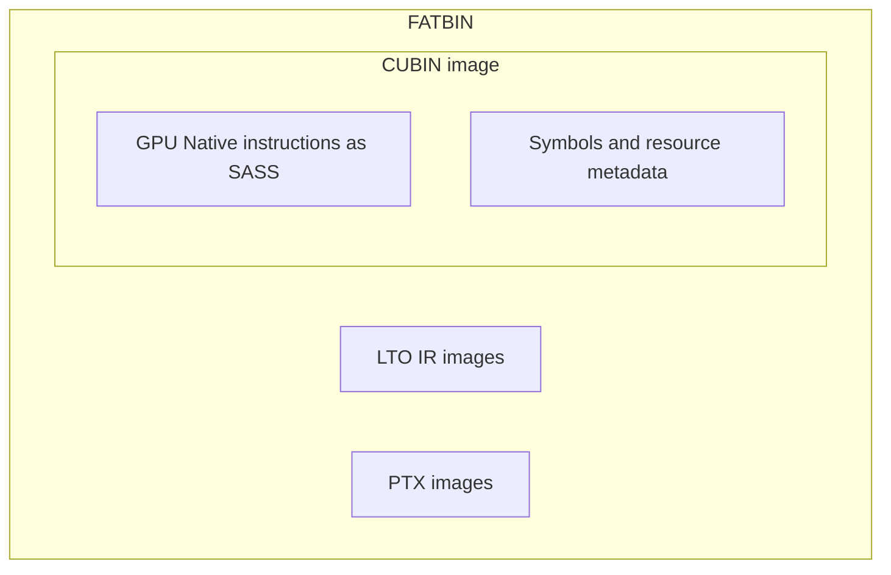
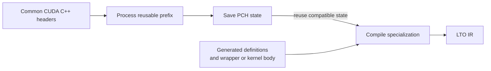

# JIT Terminology

The JIT guides use terms for code representations, compilation techniques, and compiler analysis. An **intermediate representation (IR)** describes a program between source code and executable machine code. Different IRs preserve different information and support different transformations.

## LLVM IR

**LLVM intermediate representation** is a typed, SSA-based compiler representation used for program analysis, transformation, and code generation. It can exist as an in-memory representation, readable LLVM assembly (typically `.ll`), or binary **bitcode** (typically `.bc`). Text and bitcode encode the program; neither is native GPU machine code. See the [LLVM language reference](https://llvm.org/docs/LangRef.html#introduction).

LLVM IR can describe code for many targets. Producing valid LLVM IR alone does not establish compatibility with CUDA's device compiler, its supported IR dialect, or the cuDF UDF ABI.

For example, this function adds two 32-bit integers. `%sum` is an SSA value:

```llvm
target triple = "x86_64-unknown-linux-gnu"

define i32 @add(i32 %a, i32 %b) {
entry:
  %sum = add i32 %a, %b
  ret i32 %sum
}
```

## NVVM IR

**NVVM IR** is LLVM-based IR following NVIDIA's rules for GPU device compilation. It adds conventions, restrictions, metadata, and supported intrinsics for representing device functions and kernels. An LLVM program must satisfy these requirements to be valid NVVM IR. The supported LLVM dialect and NVVM IR version depend on the CUDA toolchain and compilation target. See the [NVVM IR specification](https://docs.nvidia.com/cuda/nvvm-ir-spec/index.html).

The **libNVVM** compiler library consumes compatible NVVM IR and can produce PTX, or LTO IR with `-gen-lto`. This gives language frontends a route into CUDA compilation without first generating CUDA C++ source. See the [libNVVM API](https://docs.nvidia.com/cuda/libnvvm-api/index.html).

This device function adds `threadIdx.x` to an input. The NVIDIA intrinsic reads the thread index; the addition and return use ordinary LLVM instructions:

```llvm
target triple = "nvptx64-nvidia-cuda"

declare i32 @llvm.nvvm.read.ptx.sreg.tid.x()

define i32 @add_thread_index(i32 %base) {
entry:
  %tid = call i32 @llvm.nvvm.read.ptx.sreg.tid.x()
  %sum = add i32 %base, %tid
  ret i32 %sum
}
```



## LTO IR

**Link-time optimization intermediate representation** is the compiled device-code representation supplied to CUDA's LTO linker. It retains information that lets the linker optimize across separately compiled modules, including inlining a UDF into its calling kernel. It is not directly executable GPU code.

NVCC, the CUDA compiler driver, and NVRTC, the runtime CUDA C++ compiler library, can produce LTO IR. In libcudf, a kernel fragment and a UDF fragment can be compiled separately and combined at runtime. See [CUDA's device LTO example](https://docs.nvidia.com/cuda/nvrtc/index.html#example-device-lto-link-time-optimization).

## PTX

**Parallel Thread Execution** is NVIDIA's virtual instruction set and its textual assembly representation. It describes device instructions using virtual registers. The compiler backend translates PTX into native GPU instructions and assigns physical registers; PTX is not the machine code executed by the GPU.

PTX can be compiled ahead of time with CUDA's tools or just in time for the target GPU. PTX and LTO IR are different linker input formats: supplying PTX does not preserve the same high-level information available to device LTO. See the [PTX instruction set documentation](https://docs.nvidia.com/cuda/parallel-thread-execution/index.html).

The same `add_thread_index` device function can be written in PTX with explicit parameter loads, virtual registers, and a return-parameter store:

```ptx
.version 7.0
.target sm_80
.address_size 64

.visible .func (.param .b32 result) add_thread_index(.param .b32 base)
{
    .reg .b32 %r<3>;

    ld.param.u32 %r0, [base];
    mov.u32 %r1, %tid.x;
    add.u32 %r2, %r0, %r1;
    st.param.b32 [result], %r2;
    ret;
}
```

## FATBIN

A **fat binary**, or fatbin, is a container for CUDA code images. It can package PTX, CUBIN, and LTO IR, including variants for different GPU targets. A fatbin's format alone does not tell you which representations it contains.

Packaging images together does not link them or optimize calls between them. For example, libcudf's `add_fragment` helper packages LTO code in a fatbin; runtime linking still combines the kernel and UDF modules. See the [nvFatbin documentation](https://docs.nvidia.com/cuda/nvfatbin/index.html).

The nested boxes show containment. These are possible contents; a particular fatbin need not contain every format or multiple targets.



## CUBIN

A **CUDA binary** is a device binary in ELF format containing native GPU instructions and supporting information such as symbols and resource metadata. It targets a GPU architecture rather than PTX's virtual instruction set. A fully linked CUBIN can be loaded for execution through the CUDA driver.

libcudf's JIT linker produces a linked CUBIN from the supplied fragments, then loads it and looks up the kernel entry point. See the [nvJitLink documentation](https://docs.nvidia.com/cuda/nvjitlink/index.html).

## SASS

**SASS** refers to NVIDIA's native GPU instruction assembly. SASS describes the executable instructions; CUBIN describes the binary containing them and their metadata.

Use `cuobjdump --dump-sass kernel.cubin` to inspect these instructions. The instruction set depends on the target GPU architecture. See [CUDA Binary Utilities](https://docs.nvidia.com/cuda/cuda-binary-utilities/index.html).

## LTO

**Link-time optimization** is the optimization process, while LTO IR is a representation it consumes. The optimizer sees code from multiple modules together, allowing transformations across function and translation-unit boundaries.

**JIT-LTO** performs that linking and optimization at runtime. Preparing LTO IR ahead of time avoids repeating source compilation, while runtime linking specializes the final machine code for the selected GPU. In libcudf's authoring workflow, the kernel and UDF fragments meet at this step. See [nvJitLink](https://docs.nvidia.com/cuda/nvjitlink/index.html).

## PCH

A **precompiled header** stores compiler state produced by processing a reusable source prefix. Reusing that state reduces frontend work when compiling another specialization.

For NVRTC, `#pragma nv_hdrstop` marks the end of this prefix. libcudf places common headers before the pragma and generated specialization definitions after it. PCH reuse requires compatible compiler state and options; it is separate from caching a compiled fragment or linked kernel. See [NVRTC's PCH documentation](https://docs.nvidia.com/cuda/nvrtc/index.html#precompiled-headers-cuda-12-8).

PCH operates on the frontend side of compilation. Reusing it restores the common header state before processing a new specialization; the resulting LTO IR still needs device linking and code generation.



## SSA

**Static single assignment** is a property of a program representation: each SSA value has one definition. Reassigning a source variable is represented by defining a new value:

```text
Source:                 Conceptual SSA:
x = a + b               %x0 = ADD %a, %b
x = x * c               %x1 = MUL %x0, %c
```

This makes dependencies between computed values explicit. libcudf's [Row IR](row_ir.md) uses this style for its generated temporaries. SSA is a way of organizing a representation, rather than a CUDA binary format. [LLVM IR](#llvm-ir) is another example of an SSA-based representation; see the [LLVM language reference](https://llvm.org/docs/LangRef.html#abstract).
